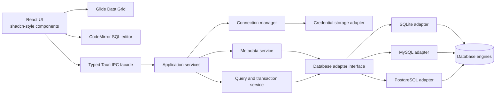

# Architecture

## 1. Architectural goals

- Keep the desktop app responsive while database operations run.
- Keep database access and credentials in the Rust backend.
- Separate the UI from database-engine specifics.
- Let UI presentation change without rewriting query or connection logic.
- Add future database engines through adapters and contract tests.
- Make data-changing operations explicit and observable.

## 2. System overview



## 3. Frontend organization

Organize by product feature, not by generic UI component type alone:

```text
src/
  app/                 # app shell, routing/tabs, global providers
  features/
    connections/       # profiles, connection lifecycle UI
    explorer/          # database tree and object metadata views
    query/             # SQL tabs, editor, run/cancel controls, history
    results/           # result state, Glide integration, value viewer, export UI
    table-data/        # paging, filters, staged edits, conflict state
    settings/          # app preferences
  components/
    ui/                # shadcn-style shared primitives
    layout/            # reusable desktop layout and split panes
  services/            # typed frontend service facade over Tauri IPC
  domain/              # frontend-safe shared types and validation
```

Feature components should use the frontend service facade rather than invoking arbitrary Tauri commands directly. This keeps IPC details and serialization out of presentation components and makes UI features easier to test or redesign.

Glide Data Grid is a presentation/interaction layer. It should consume normalized column and row data and emit user intents (selection, edit, copy); it should not own database connections or SQL generation.

## 4. Rust backend organization

```text
src-tauri/src/
  commands/            # thin Tauri command handlers and DTO conversion
  application/
    connections.rs     # profile and connection lifecycle use cases
    metadata.rs        # schema/object inspection use cases
    queries.rs         # execution, cancellation, results, history
    table_data.rs      # paging, filters, staged writes
    export.rs          # CSV generation
  domain/
    connection.rs
    result.rs
    metadata.rs
    capabilities.rs
    errors.rs
  database/
    mod.rs             # adapter contract and shared helpers
    sqlite.rs
    mysql.rs
    postgres.rs
  persistence/
    profiles.rs        # non-secret connection settings
    secrets.rs         # OS-protected credential storage boundary
```

Tauri commands should remain thin: validate/deserialize input, call an application service, and serialize a normalized result. They should not accumulate engine-specific SQL or UI policy.

## 5. Database adapter boundary

The shared adapter contract should cover the initial common workflows:

- Connect, disconnect, test connection, and report connection state.
- List databases/schemas and inspect supported object metadata.
- Execute SQL and return normalized column metadata, rows, affected-row count, duration, and structured errors.
- Cancel an operation when supported.
- Fetch table rows with paging/filter/sort inputs where safely supported.
- Apply parameterized insert/update/delete operations and report conflicts.
- Begin/commit/rollback transactions where supported.
- Report capabilities and known limitations.

Use normalized types such as `ConnectionProfile`, `ColumnInfo`, `QueryRequest`, `QueryResult`, `QueryError`, `TablePage`, `PendingChange`, and `EngineCapabilities`. Keep types serializable and avoid leaking driver-specific connection objects into Tauri IPC.

Do not force engine behavior into a false lowest-common-denominator. When semantics differ, expose a capability or engine-specific operation and make the UI handle it explicitly. Keep raw SQL available so users can use features that are not represented by generic UI workflows.

## 6. Data and query flow

1. A feature UI creates a typed request through the frontend service facade.
2. Tauri IPC sends it to a thin command handler.
3. The application service validates the request and resolves the active connection.
4. The selected engine adapter executes the operation asynchronously.
5. The backend returns normalized data and a query outcome.
6. The feature updates its own state and renders it through shared UI or Glide.

Long-running database work must not block frontend rendering. Query state should distinguish at least `queued`, `running`, `succeeded`, `failed`, `cancelled`, and `outcome_unknown` where a disconnect leaves write completion uncertain.

For large results, use a bounded/incremental data flow. Virtualized rendering reduces UI work but does not itself limit database reads or backend/frontend memory use.

## 7. Connection and credential storage

- Persist non-secret connection profile fields separately from secret values.
- Store passwords through an OS-protected credential-storage abstraction.
- The UI references a profile/secret identifier; it does not receive or persist secrets longer than needed to submit a connection request.
- Do not include secrets in diagnostics, query history, or errors.
- SQLite paths are local profile data; avoid copying or manipulating a live SQLite database file as a backup strategy.

The concrete credential-store implementation is a platform integration decision and should be selected during the connection-profile milestone.

## 8. Safety and concurrency model

### Query execution

- Track operations per connection and prevent accidental interleaving on a connection where the driver requires serialized access.
- Allow independent connections to operate independently.
- Cancellation is a request, not proof that a server-side write was rolled back. Report the actual outcome available from the driver.
- Never automatically retry a non-idempotent write after a transport failure that makes commit status uncertain.

### Table edits

- Stage edits in frontend/application state; applying them is an explicit user action.
- Use parameterized values for generated DML.
- Require a stable row identity for safe update/delete operations.
- Where practical, include original values or a version token in update predicates to detect stale rows.
- If no row was updated because the original data changed, return a conflict instead of treating it as success.
- Use transactions for a batch when supported and appropriate; preserve pending data after a failed apply so the user can inspect it.
- Do not assume every DDL statement is transactional across all engines.

### Destructive actions

- Keep the target connection/database visible at execution time.
- Use confirmations selectively for high-impact actions.
- Keep read-only mode available as a future/optional connection setting.

## 9. Error model

Normalize errors into useful categories while preserving engine details for diagnostics:

- Connection/configuration/authentication failure.
- Syntax/validation error.
- Permission failure.
- Constraint violation.
- Lock/deadlock/serialization failure.
- Timeout/cancellation.
- Transport failure with known or unknown operation outcome.
- Unsupported capability.
- Internal application error.

The UI should show a concise explanation and relevant database message, but must not show credentials or sensitive connection material. Failed operations must not be rendered as successful results.

## 10. Performance approach

- Use asynchronous backend operations and expose progress/query state.
- Fetch table/query data in bounded batches.
- Avoid fetching entire tables by default.
- Use Glide virtualization for rendering, while separately controlling fetch size and retained result memory.
- Keep transformations of large result sets out of React render paths.
- Profile with representative data before adding optimization complexity.

## 11. Testing strategy

- Unit-test normalized domain logic and engine-specific conversions.
- Run adapter contract tests against SQLite, MySQL, and PostgreSQL.
- Test IPC serialization and frontend service boundaries.
- Test feature states for loading, empty, error, pending edit, conflict, cancellation, and uncertain outcomes.
- Maintain manual workflows for connection loss, locked SQLite databases, constraint errors, concurrent row edits, cancellation, and export correctness.
- Include large-result responsiveness checks before release.

## 12. Architecture decisions and open decisions

### Current decisions

- Tauri desktop app with React/TypeScript frontend and Rust backend.
- shadcn-style UI foundation and Glide Data Grid for tabular results/data browsing.
- CodeMirror 6 as the SQL editor direction.
- SQLite, MySQL, and PostgreSQL are the initial supported engines.
- Engine-specific behavior is isolated behind adapters and normalized contracts.
- Credentials are not stored in plain-text settings.

### To validate during implementation

- Exact Rust database driver and feature configuration; SQLx is a candidate.
- Exact OS credential-store integration.
- Minimum supported operating systems.
- Glide behavior for accessibility, clipboard, keyboard navigation, and database-style inline editing.
- Result paging strategy for arbitrary SQL queries versus table browsing.
