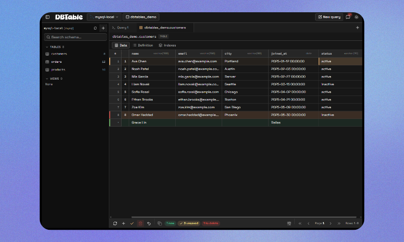
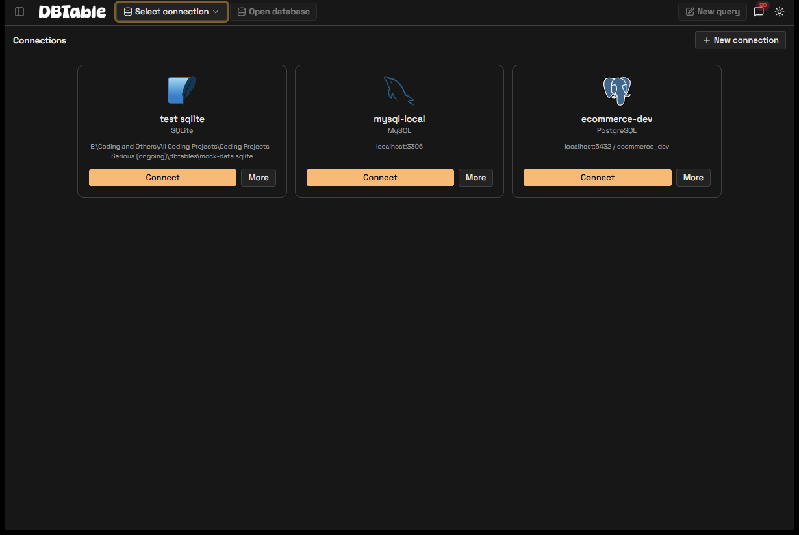
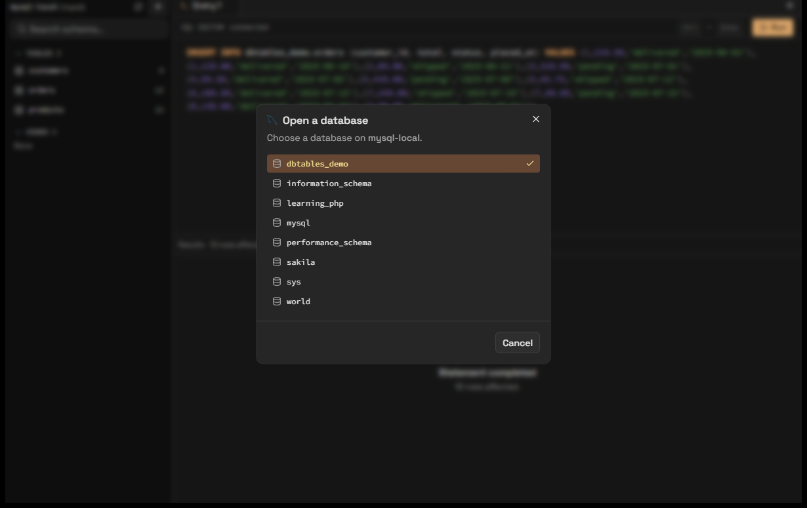
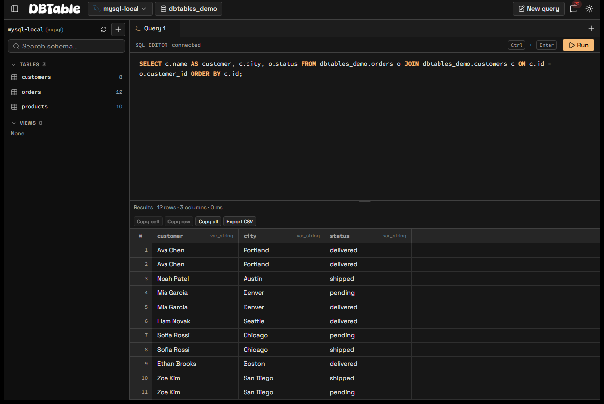
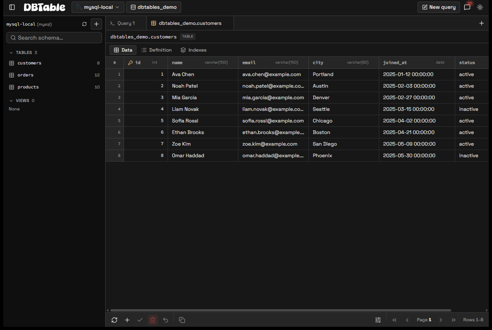
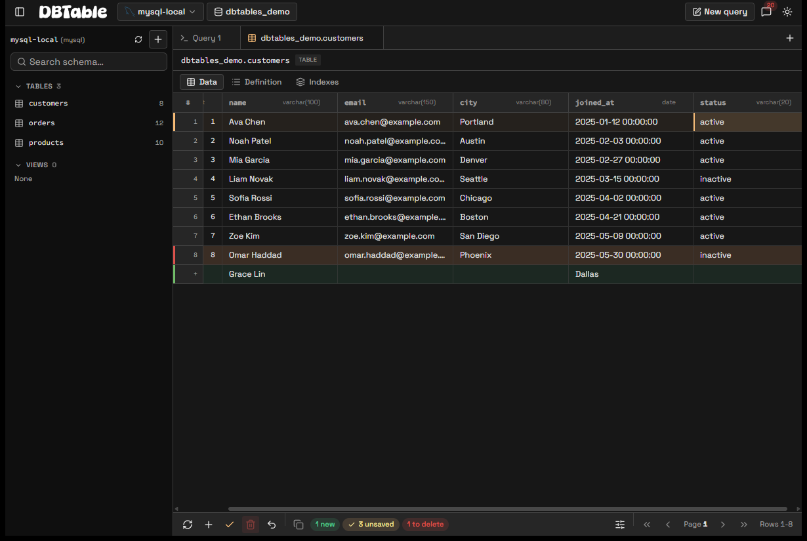
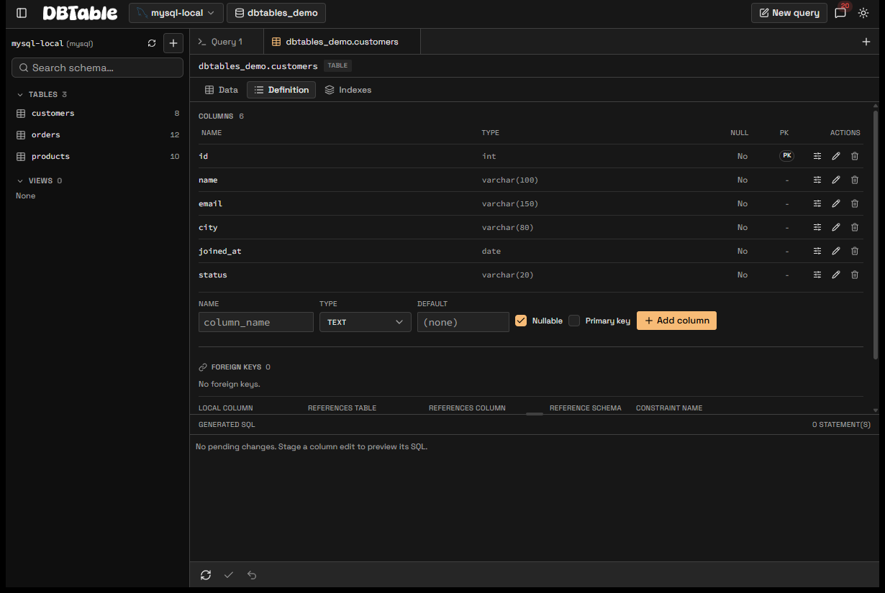
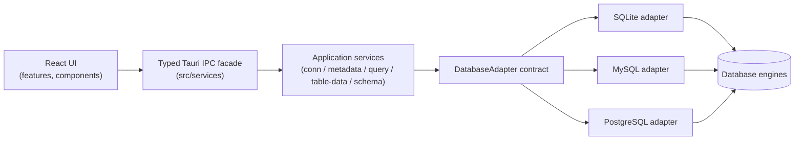

<p align="center">
  
</p>

<h1 align="center">dbtables</h1>

<p align="center">
  A fast, focused desktop database client for SQLite, MySQL, and PostgreSQL.<br>
  Connect, browse schemas, run SQL, edit table data, and export results — without the weight of a full database IDE.
</p>

<p align="center">
  
  
  
  
  
  
</p>

---

## Overview

**dbtables** is a desktop database client built as a Tauri app: a React/TypeScript
frontend over a Rust backend. The frontend never talks to a database directly —
every query, connection, and credential stays in Rust, behind a typed IPC facade.

It is designed around a small set of ideas:

- **One obvious target.** The active database is always visible, so you know
  exactly where a query or edit will land.
- **Engine-specific behavior behind adapters.** SQLite, MySQL, and PostgreSQL
  share one normalized contract; when their semantics differ, the difference is
  surfaced explicitly instead of hidden.
- **Bounded, responsive work.** Results are fetched in batches and virtualized,
  so large queries don't freeze the UI or blow up memory.
- **Deliberate, observable writes.** Table edits are staged, applied explicitly,
  and report conflicts and uncertain outcomes honestly.

## Features

- **Connection management** — save, edit, test, and remove profiles for SQLite
  files and MySQL/PostgreSQL servers; passwords are stored through the OS
  credential store, never in plain-text settings.
- **Database picker** — choose a connection, then open any database the server
  exposes (MySQL switches in place; PostgreSQL reconnects), with a shared picker
  that also opens automatically when a target database isn't set yet.
- **Schema explorer** — tables/views with row counts, search, per-object context
  menus, and a PostgreSQL schema picker.
- **SQL workspace** — CodeMirror 6 editor with SQL highlighting, run the current
  statement or selection, query status/duration, and a message log.
- **Results grid** — a themed, virtualized data grid with selection, copy, and
  CSV export; large results are paged rather than loaded wholesale.
- **Table browsing & editing** — paging, filters, sort, inline cell editing, and
  staged insert/update/delete applied explicitly with conflict detection.
- **Schema management** — create tables, add/rename/drop columns, alter a
  column's type/nullability/default (MySQL & PostgreSQL), and manage indexes and
  foreign keys, all with a generated, syntax-highlighted SQL preview.
- **Cross-engine correctness** — engine-aware identifiers, types, and DDL, so a
  MySQL preview uses backticks and a PostgreSQL one uses ANSI quotes.

## Screenshots

| Connections | Database picker |
| --- | --- |
|  |  |

| SQL workspace | Data grid |
| --- | --- |
|  |  |

| Table editing | Schema editor |
| --- | --- |
|  |  |

## Tech stack

| Layer | Choice |
| --- | --- |
| Desktop shell | [Tauri 2](https://tauri.app) |
| Frontend | React 19, TypeScript, Vite |
| UI | Tailwind CSS v4 with shadcn/ui-style primitives, lucide-react icons |
| SQL editor | CodeMirror 6 (`@codemirror/lang-sql`) |
| Data grid | Custom themed virtualized grid (`src/components/data-table`) |
| Backend | Rust — per-engine adapters over a normalized contract |
| Packaging | Tauri bundles (NSIS on Windows, app/dmg on macOS, deb/AppImage on Linux) |

## Architecture



- Presentation lives in feature folders under `src/features`; it calls the
  frontend service facade in `src/services` rather than invoking Tauri commands
  directly.
- The Rust backend is split into thin `commands/`, use-case `application/`,
  normalized `domain/`, and engine `database/` adapters.
- Engines are added by implementing the adapter contract plus contract tests —
  no shared UI rewrites.

More detail: [`ARCHITECTURE.md`](ARCHITECTURE.md).

## Getting started

### Prerequisites

- Node.js with npm
- A Rust toolchain with Cargo
- The [Tauri system prerequisites](https://tauri.app/start/prerequisites/) for
  your OS

### Run it

```sh
npm install
npm run tauri dev     # launch the desktop app with hot reload
```

### Common commands

| Command | Purpose |
| --- | --- |
| `npm run tauri dev` | Run the desktop app with hot reload. |
| `npm run check` | Type-check the frontend (`tsc --noEmit`). |
| `npm test` | Run frontend unit tests (Vitest + Testing Library). |
| `npm run rust:test` | Run the Rust test suite. |
| `npm run build` | Type-check and build the frontend bundle. |
| `npm run tauri build` | Produce a production desktop bundle for the current OS. |

### Tests

```sh
npm test                                  # frontend
npm run rust:test                         # backend
cargo test --manifest-path src-tauri/Cargo.toml --test performance -- --nocapture
```

## Project structure

```text
src/
  app/            # shell, workspace store, theme
  components/     # shadcn-style UI primitives, layout, data grid, engine logos
  features/       # connections, explorer, query, results, table-data, schema
  services/       # typed frontend facade over Tauri IPC
  domain/         # frontend-safe normalized types
  lib/            # workspace tabs, SQL helpers, utilities
src-tauri/
  src/commands/       # thin Tauri command handlers
  src/application/    # use cases (connections, metadata, queries, schema, …)
  src/domain/         # normalized, serializable domain types
  src/database/       # adapter contract + sqlite / mysql / postgres adapters
  src/persistence/    # profile storage + credential-store boundary
  tests/              # adapter contract and performance suites
docs/screenshots/     # README images
```

## Security & data safety

- Credentials are resolved from OS-protected storage; profiles persist only
  non-secret fields, and secrets never cross the IPC boundary back to the UI.
- Values are sent as bound parameters; identifiers are validated and quoted with
  engine-specific rules.
- Failed operations are never rendered as success, and a transport failure
  during a write is reported as an uncertain outcome rather than silently
  retried.
- Results are bounded (a default cap plus a hard ceiling) so a query cannot load
  an unbounded result into memory.

## Roadmap / known limitations

- Column **primary-key** changes are not yet exposed (needs engine-specific
  `ADD/DROP PRIMARY KEY`; SQLite would require a guarded table rebuild).
- **SQLite** cannot alter an existing column in place; the definition editor
  hides that action rather than faking it.
- MySQL column alterations preserve an existing default heuristically; uncommon
  expression defaults may need refinement.
- SSH tunneling, visual migrations, and triggers are out of scope for now.

## License

No license has been specified yet. This is a personal portfolio project — please
contact the author before reuse.
